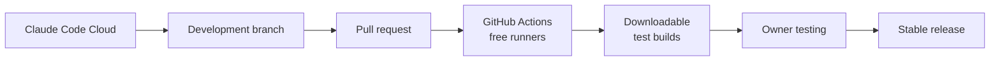

<picture>
  <source media="(prefers-reduced-motion: reduce) and (prefers-color-scheme: dark)" srcset="assets/readme/static/hero-dark.png">
  <source media="(prefers-reduced-motion: reduce)" srcset="assets/readme/static/hero-light.png">
  <source media="(prefers-color-scheme: dark)" srcset="assets/readme/hero-dark.svg">
  
</picture>

 Artwork adapts to light and dark mode automatically · <a href="https://github.com/settings/appearance">GitHub appearance settings</a>

 

**A lightweight, privacy-first, open-source desktop web browser — in its earliest stage.**

[Vision](docs/PROJECT_VISION.md) ·
[Roadmap](docs/ROADMAP.md) ·
[Feature requirements](docs/FEATURE_REQUIREMENTS.md) ·
[Development state](docs/DEVELOPMENT_STATE.md) ·
[Contributing](CONTRIBUTING.md)

> [!IMPORTANT]
> **Brizo is not usable yet.** There is no browser build, no release and no
> download. This repository currently contains the project foundation:
> documentation, design direction and tooling. Everything listed below as a
> feature is **planned**, not implemented.

<picture>
  <source media="(prefers-reduced-motion: reduce) and (prefers-color-scheme: dark)" srcset="assets/readme/static/divider-dark.png">
  <source media="(prefers-reduced-motion: reduce)" srcset="assets/readme/static/divider-light.png">
  <source media="(prefers-color-scheme: dark)" srcset="assets/readme/divider-dark.svg">
  
</picture>

## Why Brizo

Brizo takes its name from the ancient Greek deity associated with protecting
sailors and seafarers. The project aims to be the same for people on the open
web: a browser that **protects by default, stays out of the way, and respects
the machine it runs on.**

| | Principle |
| --- | --- |
| 🧭 **Freedom** | Free and open source, no lock-in, your choice of extensions. |
| 🛡️ **Privacy** | Strong content and tracker blocking built in and enabled by default. |
| 🪶 **Lightweight** | Measured resource efficiency, never at the expense of security. |
| 🌊 **Open web** | Standards-based, independent, community-reviewable. |

Read the full [project vision](docs/PROJECT_VISION.md).

## Planned core capabilities

<picture>
  <source media="(prefers-reduced-motion: reduce) and (prefers-color-scheme: dark)" srcset="assets/readme/static/pillars-dark.png">
  <source media="(prefers-reduced-motion: reduce)" srcset="assets/readme/static/pillars-light.png">
  <source media="(prefers-color-scheme: dark)" srcset="assets/readme/pillars-dark.svg">
  
</picture>

<b>Dual extension ecosystem</b> (planned, research pending)

- Chrome extensions and Firefox WebExtension add-ons managed in one place.
- Chrome Web Store and Mozilla Add-ons integration **where their terms permit**.
- CRX / XPI installation where technically and securely feasible.
- Manifest V2 / V3 compatibility research; compatibility layers where required.
- A strict, transparent permission model.

Universal compatibility is **not** promised. What is achievable depends on the
browser foundation chosen in the upcoming feasibility study.

<b>Built-in privacy engine</b> (planned)

- Advertisement, tracker and popup blocking enabled by default.
- Cosmetic filtering, EasyList / EasyPrivacy compatibility, custom filter lists.
- Per-site controls, custom rules, an element picker and advanced-user modes.

Goal: basic protection without installing a separate ad blocker.

<b>Integrated Media Grabber</b> (planned)

- Detection of video, audio and images on a page; direct downloads.
- HLS / DASH for **authorised, non-DRM** media; quality selection; audio-only.
- Bulk image download, queue with pause / resume / retry, parallel transfers.
- Audio/video merging and optional local conversion.

Brizo will **not** implement DRM circumvention or unauthorised access.
Candidate components (yt-dlp, FFmpeg, aria2) will be evaluated later.

<b>Lightweight performance</b> (planned)

- Automatic tab sleeping, smart discarding, lazy session restore.
- Memory-pressure handling, battery awareness, on-demand background services.

Sandboxing, site isolation and certificate validation will **never** be
weakened to save memory. No performance numbers will be published until they
are measured and reproducible.

<b>Modern desktop experience</b> (planned)

Horizontal and vertical tabs, tab groups, workspaces, sessions, bookmarks,
history, profiles, password management, light and dark themes,
picture-in-picture, split view, an advanced download manager, optional
userscripts and secure automatic updates. Each one is weighed against the
lightweight philosophy.

Full detail is in [docs/FEATURE_REQUIREMENTS.md](docs/FEATURE_REQUIREMENTS.md).

<picture>
  <source media="(prefers-reduced-motion: reduce) and (prefers-color-scheme: dark)" srcset="assets/readme/static/divider-dark.png">
  <source media="(prefers-reduced-motion: reduce)" srcset="assets/readme/static/divider-light.png">
  <source media="(prefers-color-scheme: dark)" srcset="assets/readme/divider-dark.svg">
  
</picture>

## Development status

**Early Development: Architecture & Foundation (Phase 0).**

| Area | Status |
| --- | --- |
| Project documentation & rules | ✅ In place (this branch) |
| Brand palette & guidelines | ✅ Drafted, owner review pending |
| Logo | 🟡 Provisional candidate, provenance & trademark **unresolved** |
| Browser engine / foundation | ⬜ Not selected; feasibility study next |
| Browser builds | ⬜ None exist |
| Releases | ⬜ None exist |

## Technical roadmap

<picture>
  <source media="(prefers-reduced-motion: reduce) and (prefers-color-scheme: dark)" srcset="assets/readme/static/roadmap-dark.png">
  <source media="(prefers-reduced-motion: reduce)" srcset="assets/readme/static/roadmap-light.png">
  <source media="(prefers-color-scheme: dark)" srcset="assets/readme/roadmap-dark.svg">
  
</picture>

Phases after Phase 1 depend on its outcome. See [docs/ROADMAP.md](docs/ROADMAP.md).

### How Brizo is built

The project is designed to need **no local toolchain and no paid
infrastructure**. Whether a full browser can realistically be built on free
GitHub-hosted runners has **not** been proven yet. Answering that is Phase 1.

## Platform targets

Long-term targets: **Windows** x64 / ARM64 · **macOS** Apple Silicon / Intel ·
**Linux** x64 / ARM64.

Initial testing priority: **1.** macOS Apple Silicon → **2.** Windows x64 → **3.** Linux x64.

> [!NOTE]
> No platform is supported today. A platform will be listed as supported only
> after a working build has been produced **and** tested on it.

## Privacy principles

- **Protection by default.** Blocking is on out of the box.
- **No telemetry by default.** Any future diagnostics will be opt-in, documented and minimal.
- **Local first.** Browsing data stays on the device unless the user chooses otherwise.
- **Transparent.** Behaviour is documented and the source is open for review.
- **No dark patterns.** Privacy settings are clear and reversible.

## Performance philosophy

- Measure first; publish only reproducible results.
- Do less in the background; start services on demand.
- Prefer sleeping and discarding idle tabs over keeping everything resident.
- **Security is not a tuning knob.** Sandboxing, site isolation and certificate
  validation stay on.

<picture>
  <source media="(prefers-reduced-motion: reduce) and (prefers-color-scheme: dark)" srcset="assets/readme/static/divider-dark.png">
  <source media="(prefers-reduced-motion: reduce)" srcset="assets/readme/static/divider-light.png">
  <source media="(prefers-color-scheme: dark)" srcset="assets/readme/divider-dark.svg">
  
</picture>

## Contributing

Brizo is at a very early stage, and design discussion is the most useful
contribution right now. Please read [CONTRIBUTING.md](CONTRIBUTING.md) and the
[security policy](SECURITY.md) first. Project decisions are recorded in
[docs/DECISIONS.md](docs/DECISIONS.md).

## Licence

**Not yet chosen, deliberately.** Brizo will be free and open source. The
licence will be selected after the browser foundation is chosen, so that it is
compatible with every upstream licensing obligation (for example BSD-style
licences for Chromium or MPL-2.0 for Firefox). Until a `LICENSE` file is added,
no licence is granted for the contents of this repository. See
[docs/DECISIONS.md](docs/DECISIONS.md).

## Brand notice

“Brizo” is a working name and has **not** received trademark clearance. The
logo shown to the owner for review is a provisional candidate whose provenance
is unresolved, so it is intentionally **not** published here. README artwork
uses original, abstract wave and wind motifs. Details:
[docs/BRAND_PROVENANCE.md](docs/BRAND_PROVENANCE.md).

 
Fast. Private. Lightweight. Open. A working tagline, pending owner approval.

