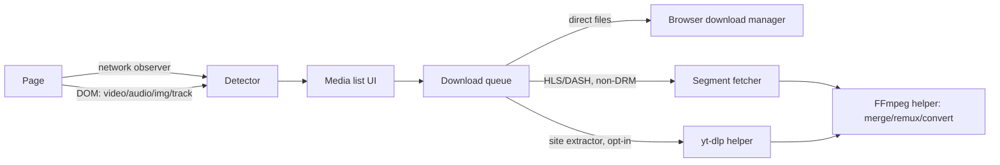

# Integrated Media Grabber Architecture

Verified 2026-11-25. Labels and IDs: [SOURCES.md](SOURCES.md).
**Hard rule:** no DRM circumvention, no paywall bypass, no access-control evasion.
Encrypted Media Extensions (EME) streams are detected and labelled "protected"; they are never downloaded.

## 1. Components

| Part | Where it runs | Notes |
| --- | --- | --- |
| Detector | Browser (privileged, per-tab) | Observes response MIME types (`video/*`, `audio/*`, `application/vnd.apple.mpegurl`, `application/dash+xml`), `<video>/<audio>/<source>/<track>`, ``/`srcset`; flags `MediaKeys`/EME use as **protected** |
| Media list UI | Toolbar panel | Quality, size and codec when known; subtitles; bulk image picker |
| Queue | Browser process | Pause, resume (HTTP Range), retry with backoff, parallel per-host limits, speed limit |
| Segment fetcher | Browser network stack | Fetches HLS/DASH segments **with the page's own request context**, so cookies never leave the browser |
| FFmpeg helper | Separate, sandboxed process, launched only when needed | Merge audio and video, remux, extract audio, optional conversion |
| yt-dlp helper | Optional download, separate process, off by default | Site extractors; user-initiated only |

## 2. Third-party tools

| Tool | Licence | Use | Risks |
| --- | --- | --- | --- |
| FFmpeg | LGPL-2.1+ by default; GPL if `--enable-gpl` (FFM1) [V] | Remux/merge/convert | Ship an **LGPL build** (no `--enable-gpl`, no `--enable-nonfree`) as a separate executable; patent-encumbered encoders off by default [A] |
| yt-dlp | Unlicense source; PyInstaller binaries are GPLv3+ (YT1) [V] | Optional site extraction | Fast-moving and frequently updated; distribute as an optional, separately licensed helper and verify the SHA-256 of signed upstream releases |
| aria2 | GPL-2.0 (AR1) [V] | Optional segmented downloader | Probably unnecessary: the browser network stack can do Range requests natively [A] |
| Native HLS/DASH parsing in-browser (own code) | Brizo licence | Default path | Smaller attack surface than external tools |

## 3. Security and privacy

- Helpers run as separate processes with the minimum arguments; no shell
  interpolation; output paths validated; on macOS/Windows use the OS sandbox
  where possible [A].
- Cookies and tokens are **never** written to disk or passed to helpers.
  Authenticated fetching stays inside the browser. If yt-dlp needs a
  login, the user must opt in per site.
- Private windows: detection works, but nothing is logged or remembered.
- Helper updates: pinned versions with SHA-256 checks; updates ship through
  Brizo's own signed update channel, never self-updating binaries.

## 4. Legal and policy

Downloading is limited to media the user is entitled to save. DRM-protected
content is not downloadable by design. Site-specific extractors are opt-in, and
their legality varies by jurisdiction and terms of service; the UI must say so [A].
